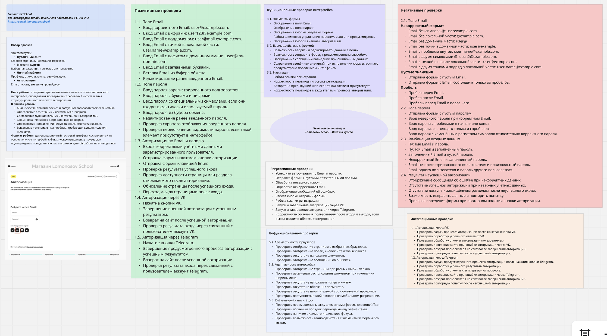

# ✅ Чек-лист: Авторизация

**Сервис:** [Lomonosov School](https://portal.lomonosov.school)
**Раздел:** Шаг 4 «Авторизация» в процессе покупки курса
**Тип проверки:** функциональное + нефункциональное + интеграционное

**Легенда приоритетов:**
- 🔴 **P0** — критично, блокирует основной сценарий
- 🟡 **P1** — важно, влияет на UX
- 🟢 **P2** — nice-to-have, не блокирует

---

## 🎨 Визуальная версия в Miro

> 📌 **Интерактивная доска:** [Открыть в Miro →](https://miro.com/app/board/uXjVJrPy4xw=/?share_link_id=327852196442)
> 👇 Скриншот для быстрого просмотра:

---

## 🎯 Цель проверки

Проверить 5 способов авторизации: **Email + Пароль**, **VK**, **Telegram**, **Discord**, **Apple**. Убедиться в корректной работе валидации, обработке ошибок, сохранении сессии и интеграции с OAuth-провайдерами.

---

## ⏱ Приоритизация (если время ограничено)

**Smoke-проверки — 30 минут:**
1. 🔴 Авторизация через Email с валидными данными
2. 🔴 Авторизация через VK
3. 🔴 Авторизация через Telegram
4. 🔴 Обработка неверного пароля
5. 🔴 Выход из аккаунта

**Расширенный набор — 2 часа:**
6. 🟡 Остальные OAuth (Discord, Apple)
7. 🟡 Валидация email и пароля
8. 🟡 Граничные значения
9. 🟢 Регрессионные и нефункциональные проверки

---

## 1️⃣ Поле Email

### 1.1. Отображение поля (UI)

- [ ] 🔴 Поле Email отображается в форме
- [ ] 🟡 Поле имеет placeholder «Email»
- [ ] 🟡 Поле маркировано как обязательное (`*`)
- [ ] 🟢 Поле доступно для ввода (не `disabled`, не `readonly`)

### 1.2. Позитивные проверки — ввод

- [ ] 🔴 Ввод корректного email (`user@example.com`) — принимается
- [ ] 🟡 Ввод email с цифрами (`user123@example.com`) — принимается
- [ ] 🟡 Ввод email с поддоменом (`user@mail.example.com`) — принимается
- [ ] 🟡 Ввод email с точкой в локальной части (`user.name@example.com`) — принимается
- [ ] 🟢 Ввод email с плюсом (`user+tag@example.com`) — принимается
- [ ] 🟢 Ввод email с дефисом в домене (`user@my-site.com`) — принимается

### 1.3. Негативные проверки — неверный формат

- [ ] 🔴 Email без символа `@` (`userexample.com`) — ошибка валидации
- [ ] 🔴 Email без локальной части (`@example.com`) — ошибка
- [ ] 🔴 Email без домена (`user@`) — ошибка
- [ ] 🟡 Email без точки в доменной части (`user@example`) — ошибка
- [ ] 🟡 Email с пробелом внутри (`user @example.com`) — ошибка
- [ ] 🟢 Email с двумя `@` (`user@@example.com`) — ошибка
- [ ] 🟢 Email с кириллицей (`юзер@example.com`) — ошибка

### 1.4. Граничные значения

- [ ] 🟡 Email из 1 символа до `@` (`a@b.co`) — принимается
- [ ] 🟡 Очень длинный email (100+ символов) — принимается или понятная ошибка
- [ ] 🟡 Email с пробелами по краям — обрезается автоматически
- [ ] 🟢 Email с заглавными буквами — нормализуется к нижнему регистру
- [ ] 🟢 Международный домен (`user@example.рф`) — принимается или отклоняется

### 1.5. Взаимодействие с полем

- [ ] 🟡 Можно редактировать введённый текст (Backspace, Delete)
- [ ] 🟡 Можно выделить весь текст (Ctrl+A) и заменить
- [ ] 🟡 Можно вставить email из буфера (Ctrl+V)
- [ ] 🟢 Можно скопировать введённый текст (Ctrl+C)
- [ ] 🟢 Очистка поля крестиком (если есть) работает

---

## 2️⃣ Поле Пароль

### 2.1. Отображение поля (UI)

- [ ] 🔴 Поле Пароль отображается в форме
- [ ] 🟡 Поле имеет placeholder «Пароль»
- [ ] 🟡 Поле маркировано как обязательное (`*`)
- [ ] 🔴 Ввод символов скрыт (точки/звёздочки)

### 2.2. Позитивные проверки — ввод

- [ ] 🔴 Ввод корректного пароля — принимается
- [ ] 🟡 Ввод пароля с буквами и цифрами — принимается
- [ ] 🟢 Ввод пароля со спецсимволами (`!@#$%^&*`) — принимается

### 2.3. Кнопка «Показать пароль»

- [ ] 🟡 Кнопка (иконка глаза) отображается
- [ ] 🟡 Клик — пароль становится видимым
- [ ] 🟡 Повторный клик — пароль снова скрыт
- [ ] 🟢 При перезагрузке страницы пароль снова скрыт

### 2.4. Негативные проверки

- [ ] 🔴 Пустое поле → ошибка «Введите пароль»
- [ ] 🟡 Пароль из 1 символа → ошибка (если есть минимальная длина)
- [ ] 🟢 Пароль только из пробелов → ошибка

### 2.5. Граничные значения

- [ ] 🟡 Пароль минимальной длины — принимается
- [ ] 🟡 Пароль максимальной длины (100+ символов) — принимается
- [ ] 🟢 Пароль с эмодзи — принимается или отклоняется
- [ ] 🟢 Пароль с кириллицей — принимается (если поддерживается)

---

## 3️⃣ Кнопка «Войти»

- [ ] 🔴 Кнопка отображается и активна
- [ ] 🟡 Hover-эффект при наведении
- [ ] 🔴 Клик с пустыми полями → ошибки валидации
- [ ] 🔴 Клик с корректными данными → переход в личный кабинет
- [ ] 🔴 Клик с неверными данными → сообщение об ошибке
- [ ] 🟡 Кнопка блокируется на время запроса (loading state)
- [ ] 🟢 Двойной клик не дублирует запрос
- [ ] 🟢 Отправка формы по Enter в поле пароля работает

---

## 4️⃣ Авторизация через VK

- [ ] 🔴 Кнопка VK кликабельна
- [ ] 🔴 Открывается окно OAuth VK
- [ ] 🔴 После подтверждения — переход в личный кабинет
- [ ] 🟡 При отказе — возврат на страницу авторизации
- [ ] 🟢 Если VK недоступен — понятная ошибка пользователю

---

## 5️⃣ Авторизация через Telegram

- [ ] 🔴 Кнопка Telegram кликабельна
- [ ] 🔴 Открывается окно Telegram OAuth
- [ ] 🔴 После подтверждения — переход в личный кабинет
- [ ] 🟡 Если аккаунт Telegram не привязан — предложение привязать
- [ ] 🟢 При отказе — возврат на страницу авторизации

---

## 6️⃣ Авторизация через Discord

- [ ] 🟡 Кнопка Discord кликабельна
- [ ] 🟡 Открывается окно Discord OAuth
- [ ] 🟡 После подтверждения — переход в личный кабинет
- [ ] 🟢 При отказе — возврат на страницу авторизации

---

## 7️⃣ Авторизация через Apple

- [ ] 🟡 Кнопка Apple кликабельна
- [ ] 🟡 Открывается окно Apple ID
- [ ] 🟡 После подтверждения — переход в личный кабинет
- [ ] 🟢 Опция «Скрыть мой email» работает
- [ ] 🟢 При отказе — возврат на страницу авторизации

---

## 8️⃣ Ссылка «Зарегистрироваться»

- [ ] 🟡 Ссылка отображается под формой
- [ ] 🟡 Ссылка кликабельна
- [ ] 🔴 Ведёт на форму регистрации
- [ ] 🟢 С формы регистрации можно вернуться к авторизации

---

## 9️⃣ Сессия и выход

- [ ] 🔴 После входа — редирект в личный кабинет
- [ ] 🔴 Сессия сохраняется при перезагрузке страницы
- [ ] 🟡 Сессия сохраняется при закрытии/открытии браузера (если «запомнить меня»)
- [ ] 🔴 Кнопка «Выйти» в личном кабинете работает
- [ ] 🔴 После выхода — редирект на страницу авторизации
- [ ] 🟡 После выхода — нельзя вернуться по кнопке «назад» в браузере

---

## 🔟 Безопасность (опционально)

> ⚠️ Раздел **не включён в публичную версию** чек-листа, чтобы не создавать подсказки для потенциальных атак. В приватной версии проверяется:
> - Защита от user enumeration (общее сообщение об ошибке)
> - HTTPS на всех этапах авторизации
> - Cookies с флагами `HttpOnly` и `Secure`
> - Rate limiting после неудачных попыток
> - Капча или блокировка после N попыток

---

## 🔁 Нефункциональные проверки

### 11.1. Кросс-браузерность

- [ ] 🟡 Chrome (последняя версия)
- [ ] 🟡 Firefox
- [ ] 🟢 Safari
- [ ] 🟢 Edge
- [ ] 🟢 Мобильная версия (Chrome Mobile / Safari Mobile)

### 11.2. Адаптивность

- [ ] 🟡 Десктоп (1920×1080) — вёрстка не разъезжается
- [ ] 🟡 Планшет (768×1024) — элементы читаемы
- [ ] 🟡 Мобильный (375×667) — все кнопки доступны
- [ ] 🟢 Кнопки OAuth не перекрывают друг друга
- [ ] 🟢 Поле пароля удобно вводить на мобильном

### 11.3. Клавиатурная навигация

- [ ] 🟢 Tab перемещает фокус между полями по порядку
- [ ] 🟢 Enter отправляет форму
- [ ] 🟢 Есть видимый индикатор фокуса на активном элементе
- [ ] 🟢 Можно взаимодействовать со всеми элементами формы только с клавиатуры

---

## 📋 Критерии выхода

**Чек-лист считается пройденным, если:**

1. ✅ Все 🔴 **P0-проверки** — пройдены
2. ✅ Не менее 90% 🟡 **P1-проверок** — пройдены
3. ✅ 🟢 **P2-проверки** — задокументированы (пройдены или отложены с обоснованием)
4. ✅ Все найденные дефекты заведены в трекер
5. ✅ Критичные дефекты (Blocker / Critical) не остаются открытыми

---

## 🎯 Итог

- **Всего проверок:** ~85
- **🔴 P0:** 18 (критично)
- **🟡 P1:** 40 (важно)
- **🟢 P2:** 27 (nice-to-have)
- **Пройдено:** —
- **Найдено дефектов:** —
- **Статус:** черновик

---

**Автор:** Yulia Timacheva
**Сервис:** [portal.lomonosov.school](https://portal.lomonosov.school)
