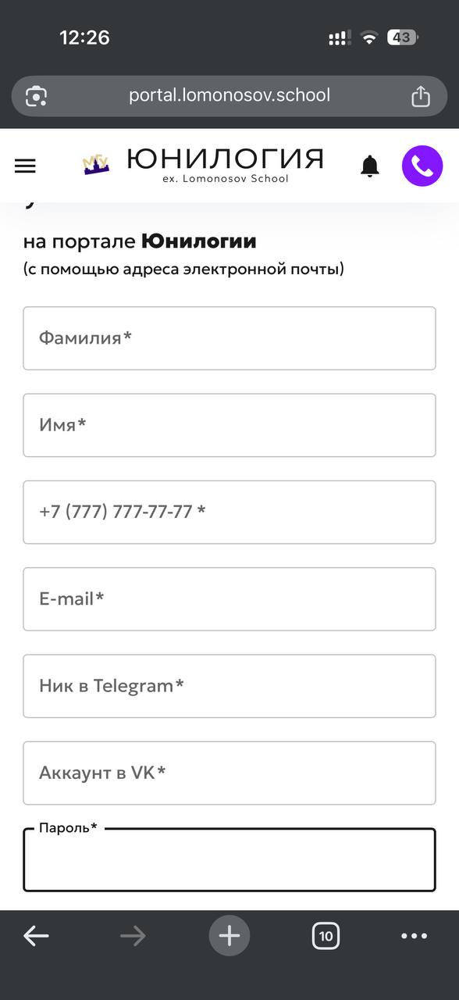

# Тест-дизайн: форма регистрации Lomonosov.school

**Объект тестирования:** форма регистрации на [Lomonosov.school](https://lomonosov.school/)

В форме есть семь обязательных полей: фамилия, имя, телефон, Email, ник в Telegram, аккаунт VK и пароль. Также предусмотрен чекбокс согласия на обработку персональных данных.

Для подготовки тестов использованы четыре техники тест-дизайна.

## 📸 Анализируемая форма

## Условия и допущения

**Подтверждено:**
- Форма содержит 7 обязательных полей.
- Есть чекбокс согласия на обработку персональных данных.

**Требует уточнения:**
- Минимальная и максимальная длина полей.
- Допустимые символы для фамилии, имени и пароля.
- Правила проверки номера телефона.
- Требования к формату Email.
- Допустимый формат ника в Telegram и аккаунта VK.
- Тексты ошибок и способ их отображения.

Если требования недоступны, примеры в документе используются для демонстрации техник тест-дизайна, а не как описание фактических правил Lomonosov.school.

## 1. Классы эквивалентности

Проверяю, как форма обрабатывает разные типы данных: корректные значения, пустые поля и потенциально некорректный ввод.

| Поле | Тестовые данные | Что проверяю |
|---|---|---|
| Фамилия | `Иванова` | Ввод обычного текста |
| Фамилия | Пустое значение | Обязательность поля |
| Имя | `Анна` | Ввод обычного текста |
| Имя | Пустое значение | Обязательность поля |
| Телефон | `+79991234567` | Обработку номера телефона |
| Телефон | `123` | Обработку короткого номера |
| Телефон | Пустое значение | Обязательность поля |
| Email | `user@example.com` | Обработку Email стандартного формата |
| Email | `userexample.com` | Обработку адреса без `@` |
| Email | Пустое значение | Обязательность поля |
| Ник в Telegram | `@test_user` | Обработку заполненного поля |
| Ник в Telegram | Пустое значение | Обязательность поля |
| Аккаунт VK | `https://vk.com/example` | Обработку ссылки на аккаунт |
| Аккаунт VK | Пустое значение | Обязательность поля |
| Пароль | `TestPass123!` | Обработку заполненного поля |
| Пароль | `Ab1!` | Проверку короткого пароля |
| Пароль | Пустое значение | Обязательность поля |

Для имени и фамилии дополнительно можно проверить ввод пробелов, цифр и специальных символов.

## 2. Граничные значения

Проверяю значения около минимально и максимально допустимой длины поля.

Точные ограничения Lomonosov.school в этом документе не подтверждены. Поэтому для примера рассмотрим условное требование: пароль должен содержать от 8 до 20 символов.

| Длина пароля | Ожидаемый результат при условном ограничении |
|---|---|
| 7 символов | Не проходит проверку длины |
| 8 символов | Проходит проверку длины |
| 9 символов | Проходит проверку длины |
| 19 символов | Проходит проверку длины |
| 20 символов | Проходит проверку длины |
| 21 символ | Не проходит проверку длины |

По такому же принципу можно проверить длину фамилии, имени, телефона и других полей — после уточнения установленных для них ограничений.

## 3. Таблица принятия решений

Проверяю, зависит ли возможность отправки формы от заполненности обязательных полей и согласия на обработку персональных данных.

| Все семь полей заполнены | Согласие отмечено | Ожидаемый результат |
|---|---|---|
| Да | Да | Форма проходит проверку обязательности полей и согласия |
| Да | Нет | Форма не должна отправляться успешно |
| Нет | Да | Форма не должна отправляться успешно |
| Нет | Нет | Форма не должна отправляться успешно |

Дополнительно проверяю каждое обязательное поле отдельно: оставляю его пустым, а остальные поля заполняю. Это позволяет убедиться, что проверка обязательности работает для всех семи полей.

## 4. Попарное тестирование

Использую эту технику, чтобы проверить сочетания нескольких параметров без перебора всех возможных комбинаций.

Для примера выбраны три параметра:

- фамилия — заполнена / пустая;
- Email — корректный / некорректный формат;
- пароль — соответствует условным требованиям / не соответствует им.

Всего возможно \(2 \times 2 \times 2 = 8\) комбинаций. Для демонстрации попарного покрытия достаточно следующих четырёх:

| № | Фамилия | Email | Пароль |
|---|---|---|---|
| 1 | Заполнена | Корректный | Соответствует требованиям |
| 2 | Заполнена | Некорректный | Не соответствует требованиям |
| 3 | Пустая | Корректный | Не соответствует требованиям |
| 4 | Пустая | Некорректный | Соответствует требованиям |

В этих четырёх тестах встречаются все сочетания значений для каждой пары параметров. Например, для пары «Фамилия + Email» проверяются все варианты: заполненная или пустая фамилия вместе с корректным или некорректным Email.

Это учебный пример для трёх параметров, а не полный набор проверок формы.

## Примечание

Документ демонстрирует подготовку тестовых сценариев. Приведённые проверки не отмечены как выполненные, а ограничения длины пароля используются только для примера. Перед реальным тестированием необходимо уточнить правила валидации формы.
